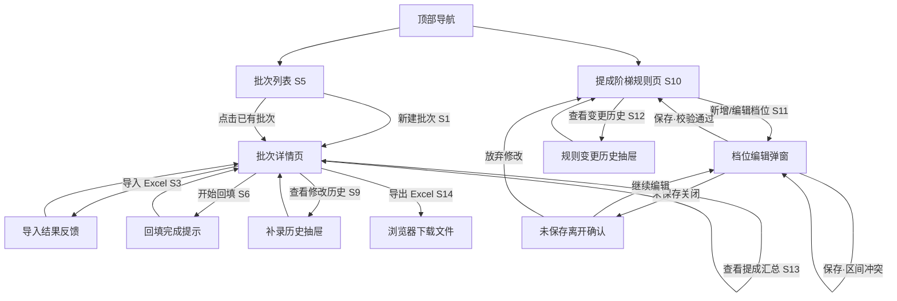

# UX Flows · v1

## 场景列表

### 功能：批次管理与 Excel 导入
- S1：用户从「提成批次」列表页点击"新建批次"，填写批次名称提交，进入该批次的详情页（初始状态"进行中"）。
- S2：用户在批次详情页点击状态标签，在「进行中/已完成」间手动切换。
- S3：用户在批次详情页点击"导入 Excel"，弹窗选择本地文件并点击"开始导入"，看到"成功 N 行/失败 M 行"及失败行清单。
- S4：用户在导入记录列表里点击某次导入的"删除"，二次确认后该次导入产生的记录消失。
- S5：用户在批次列表/保单记录明细列表中浏览、搜索（工作单号/保单号/客户名称），空批次/空明细展示引导创建的空态。

### 功能：销售人员回填与人工补录
- S6：用户在批次详情页点击"开始回填"，系统对待处理记录尝试回填（本期因接口未配置，全部落回"未匹配"）。
- S7：用户用"回填状态"筛选器筛出"未匹配"的记录集中处理。
- S8：用户点击保单记录整行展开编辑区，填写/修改销售人员姓名并保存，该行标记为"人工补录"。
- S9：用户点击"查看修改历史"，在右侧抽屉查看该记录的补录日志（谁/何时/旧值→新值）。

### 功能：提成阶梯规则管理
- S10：用户从「提成阶梯规则」入口进入管理页，查看当前完整阶梯表。
- S11：用户点击"新增档位"或某档的"编辑"，在弹窗中填写下限/上限/单价并保存；区间冲突时提示并阻止保存；编辑到一半关闭弹窗会先弹"未保存离开"确认。
- S12：用户点击"查看变更历史"，在右侧抽屉查看阶梯规则的完整修改日志。

### 功能：提成报表导出
- S13：用户打开批次详情页，查看按投保人分组的实时提成汇总卡片（销售/票数/提成，局部定档）；未配置规则或某投保人下全员未匹配时分别展示对应提示。
- S14：用户点击"导出 Excel"，浏览器下载按投保人分 sheet 的报表文件。

## 流程图

